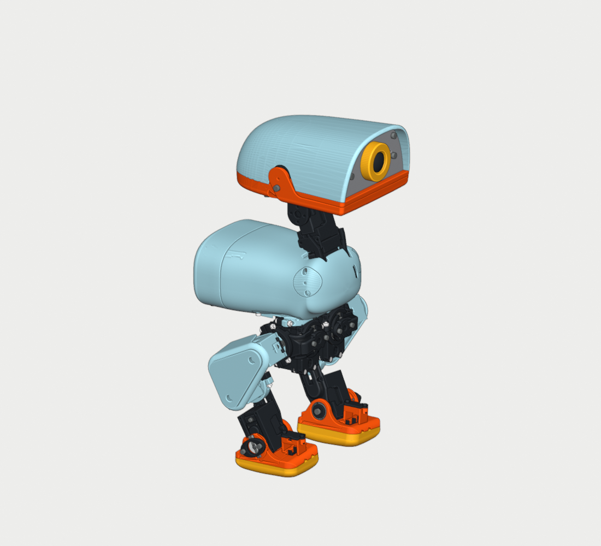

# Microduck V15 R2

Un robot bípedo imprimible con la carrocería redondeada V15, Raspberry Pi Zero 2 W en la cabeza y 15 MG90S **de posición**. Hay 14 articulaciones activas; el servo físico 09 de la mandíbula queda desconectado (PCA 14). Esta revisión conserva la forma aprobada y sus accesos de servicio.



| Paso | Qué encontrarás |
|---|---|
| 1. [Lista de materiales](docs/01-materiales.md) | Piezas, referencias de compra, batería, tornillería, útiles y equivalencias permitidas por medidas. |
| 2. [Impresión y montaje](docs/02-montaje.md) | Probetas, capas de pausa, orden por subconjuntos, despiece, montaje y servicio. |
| 3. [Electricidad](docs/03-electricidad.md) | Esquema, pinout, arnés, fusible, carga y pruebas de banco. |
| 4. [Instalación y calibración](docs/04-puesta-en-marcha.md) | Preparar la Pi, revisar sensores, calibrar servos y probar el robot con soporte. |
| 5. [Programación](docs/05-programacion.md) | Formato de secuencias, ejemplos, API, telemetría, comprobaciones y solución de fallos. |
| 6. [CAD y evidencias](docs/06-cad.md) | Blender editable, integridad de archivos, vistas y límites de la comprobación. |

Antes de imprimir el robot entero, imprime las cinco probetas de [fabricacion/PROBETAS_PRIMERO](fabricacion/PROBETAS_PRIMERO) y monta un piloto con los herrajes y el servo de tu lote. Hay 80 STL en [fabricacion/STL_POR_COLORES](fabricacion/STL_POR_COLORES), separados por color y material, y nueve [proyectos de PrusaSlicer con pausas](fabricacion/PROYECTOS_PRUSA_PAUSAS). La [guía ilustrada HTML](fabricacion/DOCUMENTACION/GUIA_IMPRESION_Y_MONTAJE_V15.html) se abre sin conexión desde la carpeta del repositorio. Contiene enlaces relativos a sus tablas y vistas.

Prueba el software en el ordenador con **Python 3.10 o posterior**, sin placa ni paquetes adicionales. Ejecuta desde la raíz:

```sh
python tools/verify_repo.py
python tools/test_software.py
python tools/run_robot.py doctor
python tools/run_robot.py ejecutar examples/02_cabeza.json
```

En sistemas que instalan Python como `python3`, usa ese comando. Para ver o editar el modelo con Blender 4.5 LTS, ejecuta `python tools/restore_cad.py` y abre el archivo que indica. La reconstrucción usa sólo los fragmentos incluidos y comprueba el SHA-256 del CAD público. Git LFS no es necesario. El CAD público muestra la placa distribuidora como una envolvente dimensional; las piezas imprimibles conservan su geometría.

La revisión de CAD y el laminado se completaron sobre las piezas entregadas. La prueba con tus piezas impresas, el ajuste del lote, las medidas eléctricas y la calibración de cada servo son tareas de la primera unidad. El software incluye diagnóstico, calibración, telemetría y movimientos supervisados en banco; no hay una marcha ni una recuperación de caídas validadas para esta geometría. No cargues la política del modelo de entrenamiento anterior.

Lee [SOURCES.md](SOURCES.md) antes de redistribuir modelos o referencias de terceros.
