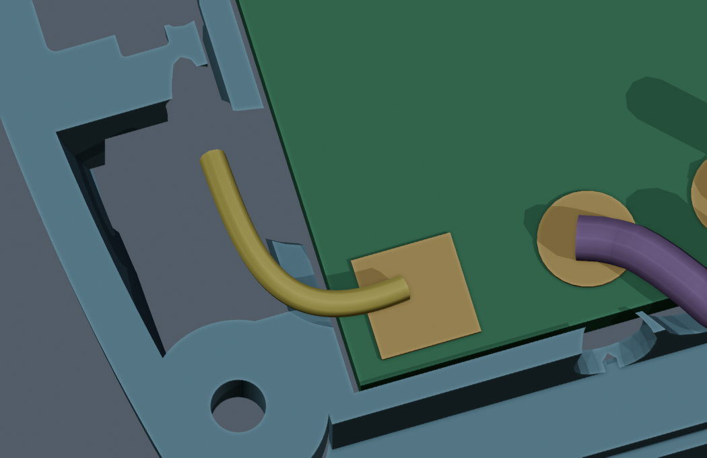

# Microduck V16 R1 G10

[Descargar el robot entero para la P2S](https://github.com/MTNRS/microduck-v15/releases/download/v16-r1-g10/Microduck_G10_completo_P2S.zip) · [Descargar solo P45](https://github.com/MTNRS/microduck-v15/releases/download/v16-r1-g10/Microduck_G10_P45_P2S.zip) · [Ver todos los archivos de la publicación](https://github.com/MTNRS/microduck-v15/releases/tag/v16-r1-g10)

El paquete principal incluye el montaje y el despiece en Blender, los 86 STL por colores, nueve proyectos Bambu Studio y sus nueve archivos laminados para la P2S con boquilla de 0,4 mm. Hay seis pausas para tuercas. La escena 06 muestra la entrada de la placa de protección. La escena 10 muestra el cable amarillo BM en el canal interior de P45. [Guía del robot](LEEME.md) · [Montaje del cassette](Montaje_del_canal_BM.md) · [Componentes](Lista_de_componentes.csv) · [Materiales](Lista_de_materiales.csv) · [Tornillos](Tornillos_para_comprar.csv)

La revisión está publicada para ensayos de montaje con el pack desconectado. El canal deja 0,47 mm de paso durante la inserción nominal. En el conjunto quedan 24 pares de fundas con solapamiento y 31 avisos frente a electrónica o herrajes. Falta validar el montaje físico. Las fuentes de desarrollo incluyen ensayos descartados. Los nueve proyectos de la descarga principal identifican la geometría de la G10.

