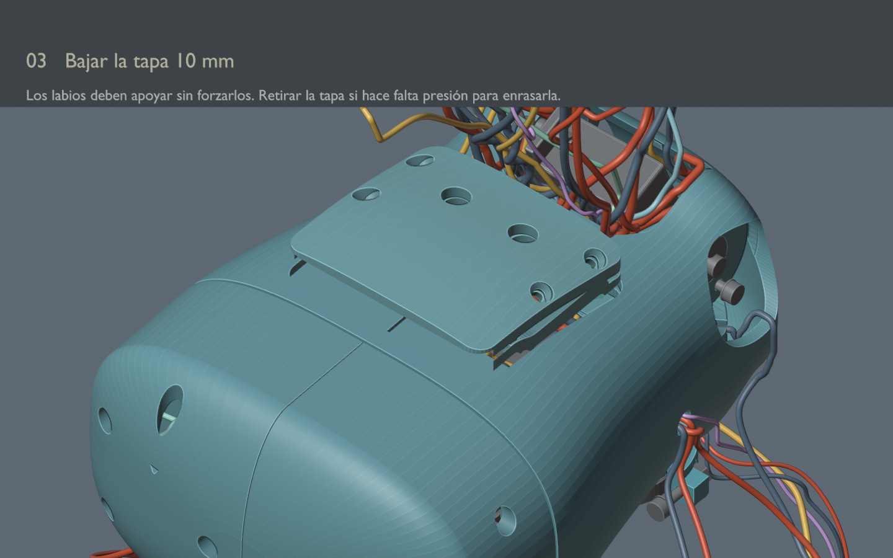

# Microduck V16 R1 G9

## Prueba de cierre del pecho para la Bambu Lab P2S

Si ya imprimiste la G8, sustituye únicamente P86 para probar el cierre. El repuesto en PETG azul cielo consume 11,38 g con boquilla de 0,4 mm. Incluye el proyecto editable, el archivo laminado y el montaje ilustrado. [Descargar solo P86](https://github.com/MTNRS/microduck-v15/releases/download/v16-r1-g9/Microduck_G9_P86_repuesto_P2S.zip)

El robot entero incluye el montaje en Blender, 86 STL por colores y nueve placas con seis pausas para tuercas. La escena 04 reproduce la entrada de la tapa, el descenso hasta su asiento y el acceso a los cuatro tornillos. [Descargar el Microduck entero](https://github.com/MTNRS/microduck-v15/releases/download/v16-r1-g9/Microduck_G9_P2S_ensayo_de_cierre.zip)

La tapa pasa a un mínimo de 0,66 mm de las fundas en el barrido CAD conservador con los 153 conductores nominales. La comprobación de la trayectoria frente a 782 sólidos incluye el asiento previsto en P44. El arnés interior sigue en ensayo con 29 solapamientos entre pares de fundas y 31 avisos ante electrónica o herrajes. Presenta las piezas con el pack desconectado. Quedan por verificar el mazo instalado y el cierre físico.

[Secuencia de P86](Montaje_de_P86.md) · [Materiales](Lista_de_materiales.csv) · [Componentes](Lista_de_componentes.csv) · [Tornillería](Tornillos_para_comprar.csv)

